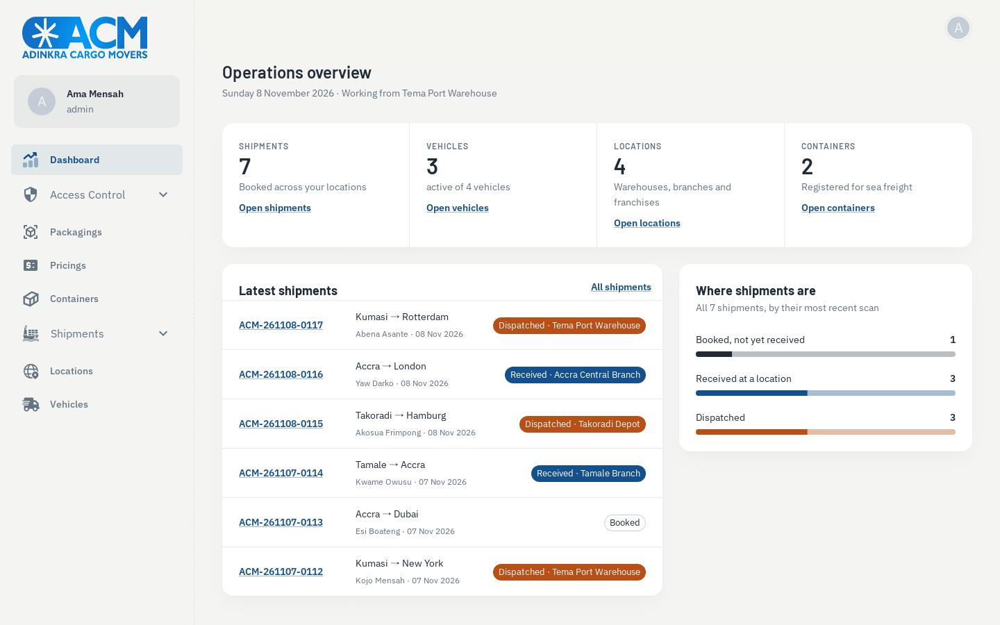
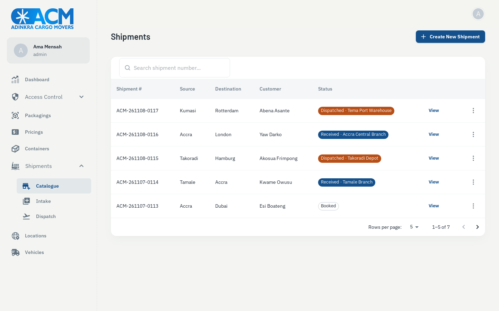
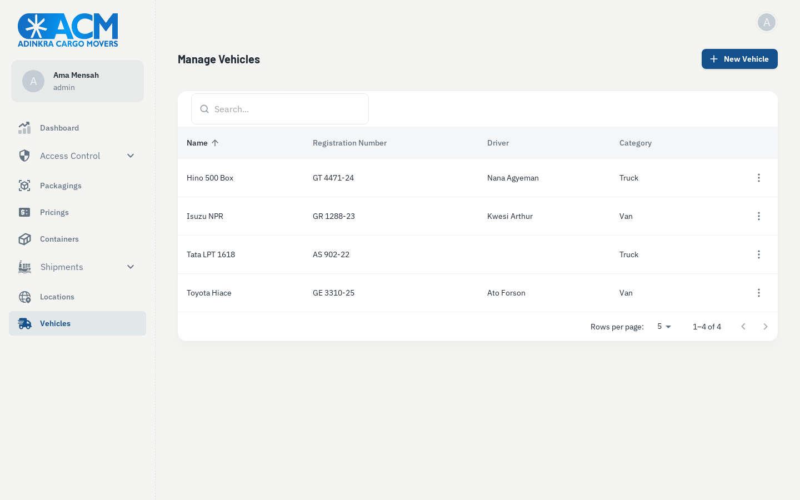
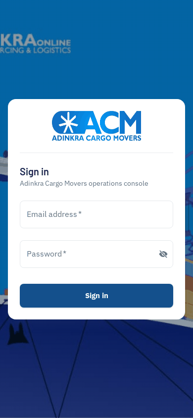
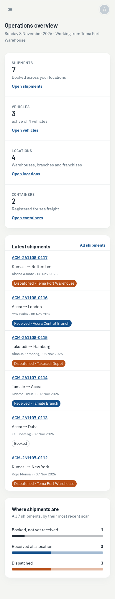
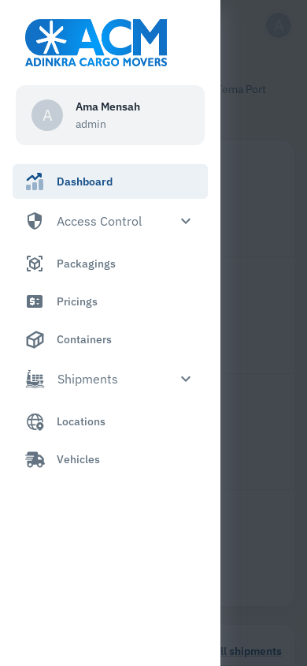
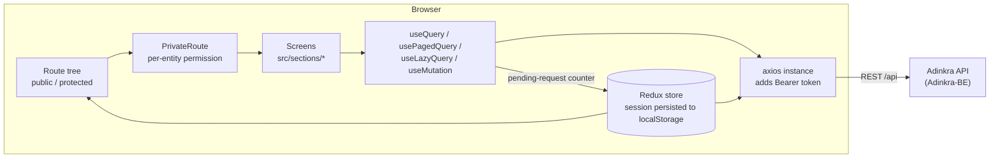

# Adinkra Console

The operator console for Adinkra Cargo Movers, a cargo and logistics business.
Branch and warehouse staff use it to book shipments, scan them in and out of
locations, price routes, and manage packaging types, vehicles, containers,
locations, users and roles. It is a React 18 single-page app on MUI 5 and Redux
Toolkit, and it talks to the Adinkra API (the `Adinkra-BE` project).



## What it does

- **Operations overview.** Shipment, vehicle, location and container counts, the
  latest shipments with their most recent scan, and how recent shipments split
  between booked, received and dispatched. Each figure is fetched only if the
  signed-in role may view that entity.
- **Shipments.** Book a shipment (sender, receiver, parcels, packaging, priced
  route), record **intake** at a location and **dispatch** onto a vehicle,
  follow the scan history, and print a PDF invoice with a barcode.
- **Reference data.** Packaging types, route pricing, containers, vehicles and
  locations, each with list, view, edit and delete.
- **Access control.** Users and roles. A role is a set of per-entity
  permissions (`view`, `add`, `update`, `remove`). The sidebar, the routes and
  the row menus all read the same permission list, so a dispatcher never sees
  a screen they would get a 403 on.

| Shipments | Vehicles |
| --- | --- |
|  |  |

It works at phone width too: the sidebar becomes a drawer and the overview
stacks.

<p>
  
  
  
</p>

## Running it

The API has to be running first; see the `Adinkra-BE` README. By default the
console expects it at `http://localhost:3006/api`.

### With Docker

```bash
cp .env.example .env        # API URL, and a Google Maps key if you want address autocomplete
docker compose up --build   # http://localhost:3010
```

Sign in with the admin account the backend's seed script creates.

Create React App writes `REACT_APP_*` values into the bundle at build time, so
Compose passes them as build arguments. After changing `.env`, rebuild with
`docker compose up --build`.

### Without Docker

You need Node 22 (`.nvmrc`) and Yarn 1.

```bash
yarn install
cp .env.example .env
yarn start                  # http://localhost:3000
```

| Command | What it does |
| --- | --- |
| `yarn start` | Dev server with hot reload |
| `yarn build` | Production bundle in `build/` |
| `yarn test` | Jest + Testing Library suite (add `--watchAll=false` for a single run) |
| `yarn lint` | ESLint over `src/` |
| `yarn prettier` | Format `src/` |

A production build needs about 1.5 GB of heap. The Dockerfile sets
`NODE_OPTIONS=--max-old-space-size=1536`; set the same locally if the build
runs out of memory.

### Configuration

| Variable | Purpose |
| --- | --- |
| `REACT_APP_API_URL` | Base URL of the Adinkra API as the browser sees it |
| `REACT_APP_GOOGLE_MAPS_API_KEY` | Optional. Enables Places autocomplete on the location form. Without it the form takes typed addresses and Maps is never loaded |

A Maps key is public by design, since it ships in the page, so restrict it to
your own domains in the Google Cloud console.

## How it fits together



```
src/
  api/            axios instance and the request hooks
  routes/         public and protected route trees, PrivateRoute
  layouts/        dashboard shell, sidebar, account menu
  sections/       one folder per screen (view + table rows + utils)
  components/     shared UI: forms, tables, list states, stage chip
  state/          Redux Toolkit slices and the persisted store
  theme/          palette, typography and MUI overrides
  test/           MSW server, fixtures and render helper for tests
```

## Design notes

- **Session.** Login returns a JWT whose `id` claim carries the user record, plus
  the role's permissions and the user's locations. The console decodes it,
  keeps it in Redux, and persists only that slice; the loading state is never
  persisted. There is no refresh token yet, so an expired session shows up as a
  401 and the user signs in again.
- **Paging.** Users and shipments are paged and searched by the API
  (`pageNumber`, `pageSize`, `search`); the smaller reference lists come back
  whole and are filtered in the browser.
- **One loading signal.** Every request bumps a pending-request counter. A
  backdrop blocks input while anything is in flight, so a form can't be
  submitted twice, and each list has its own skeleton, error-with-retry and
  empty state.
- **Look.** Harbour navy from the ACM logo, container orange for dispatch and
  keyboard focus, Barlow for headings and figures, IBM Plex Sans for tables and
  forms.

## Tests

`yarn test` runs 29 tests with Jest (via `react-scripts`), React Testing
Library and MSW 1.x, offline. They cover sign-in success and failure,
server-side paging and search on the users list, list empty and error states,
the overview's figures and permission gating, route and sidebar permissions,
container row actions, the request interceptor, and the permission, error and
loading helpers. Fixtures in `src/test/server.js` are invented demo records.

The screenshots in `docs/screenshots/` were taken from a production build in
Playwright, with every API call answered by demo data.

## Known limitations

- The order and pricing forms run effects inside Formik's render callback. That
  works because Formik calls it once per render, but those forms should move to
  a child component. ESLint's rules-of-hooks check is switched off for those
  two files until they do.
- The locations endpoint doesn't include each location's city, so every row
  makes its own city request.
- Create React App is no longer maintained. Moving to Vite would unlock current
  majors of MUI, React Router and React.

## License

MIT; see [LICENSE](LICENSE).
